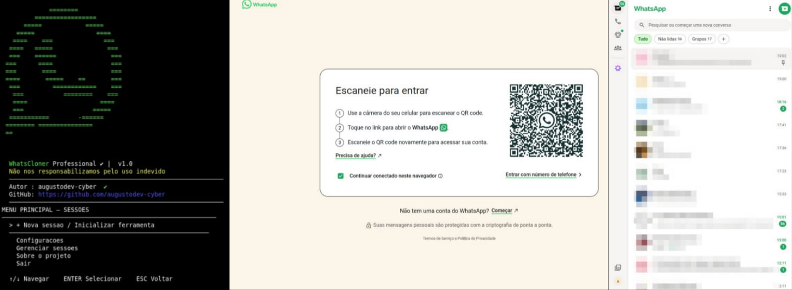

# WhatsCloner Professional

<p align="center">
  
</p>

<h3 align="center">Framework de Pentest para Segurança do WhatsApp</h3>

<p align="center">
  <strong>Pentest • Red Team • Análise de Sessões • Segurança de Autenticação</strong>
</p>

<p align="center">
  
  
  
  
</p>

---

## Sobre o projeto

**WhatsCloner** é uma ferramenta de Pentest desenvolvida em Python, direcionada à avaliação de segurança dos mecanismos de autenticação, vinculação de dispositivos e gerenciamento de sessões do WhatsApp Web.

Desenvolvida com uma abordagem voltada a operações de Red Team e pesquisas em segurança ofensiva, a ferramenta explora conceitos relacionados a *WhatsApp Session Hijacking*, autenticação por QR Code e persistência de sessões.

A aplicação disponibiliza uma interface interativa no terminal, automação de navegador e um painel web para monitoramento do ambiente de testes.

Seu propósito é auxiliar profissionais de segurança da informação, pesquisadores e estudantes na compreensão de possíveis vetores de ataque e dos riscos associados aos mecanismos de autenticação do WhatsApp.

### Opções disponíveis

| Opção | Descrição |
|---|---|
| Nova sessão / Inicializar ferramenta | Inicialização de um novo ambiente de teste |
| Configurações | Acesso às configurações da aplicação |
| Gerenciar sessões | Gerenciamento das sessões registradas |
| Sobre o projeto | Informações sobre a ferramenta |
| Sair | Encerramento da aplicação |

## Instalação

Clone o repositório:

```bash
git clone https://github.com/augustodev-cyber/WhatsCloner.git
```

Entre no diretório:

```bash
cd WhatsCloner
```

Configure as permissões:

```bash
chmod +x install.sh run.sh
```

Instale as dependências:

```bash
./install.sh
```

## Como utilizar

Inicialize a ferramenta:

```bash
./run.sh
```

Utilize as teclas direcionais para navegar pelo menu:

- `↑ / ↓` — Navegar pelas opções.
- `ENTER` — Selecionar uma opção.
- `ESC` — Retornar ao menu anterior.

Siga as instruções apresentadas no terminal para inicializar o ambiente de testes e acessar a interface web.

## Aviso legal

O WhatsCloner foi desenvolvido para fins educacionais, auditorias de segurança autorizadas, pesquisas em cibersegurança e exercícios controlados de Red Team.

A utilização deve ser restrita a contas próprias, dispositivos de teste ou ambientes cujo proprietário tenha concedido autorização expressa.

O projeto não deve ser utilizado para obtenção de acesso não autorizado, captura de sessões de terceiros ou violação de privacidade.

O desenvolvedor não se responsabiliza por danos ou atividades ilícitas decorrentes do uso indevido da ferramenta.

O WhatsCloner é um projeto independente, sem vínculo oficial com WhatsApp ou Meta.

## Desenvolvedor

**AugustoDev-Cyber**

GitHub: https://github.com/augustodev-cyber

- **Projeto:** WhatsCloner Professional
- **Versão:** 1.0
- **Categoria:** Pentest / Segurança do WhatsApp
- **Linguagem:** Python

---

<p align="center">
  <strong>WhatsCloner Professional</strong>
  <br>
  <sub>Framework de Pesquisa e Avaliação de Segurança</sub>
  <br><br>
  <strong>Identificar. Avaliar. Proteger.</strong>
</p>
